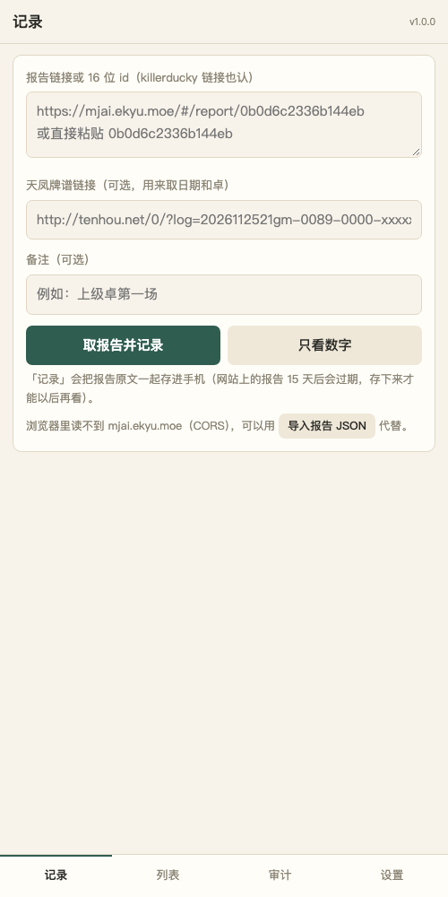
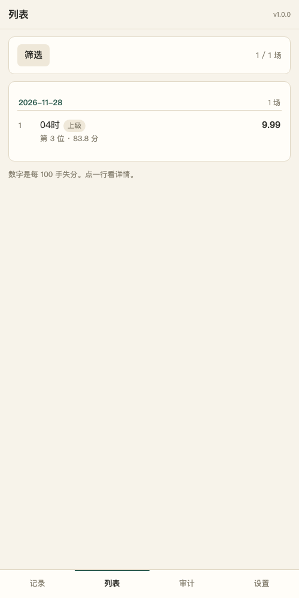
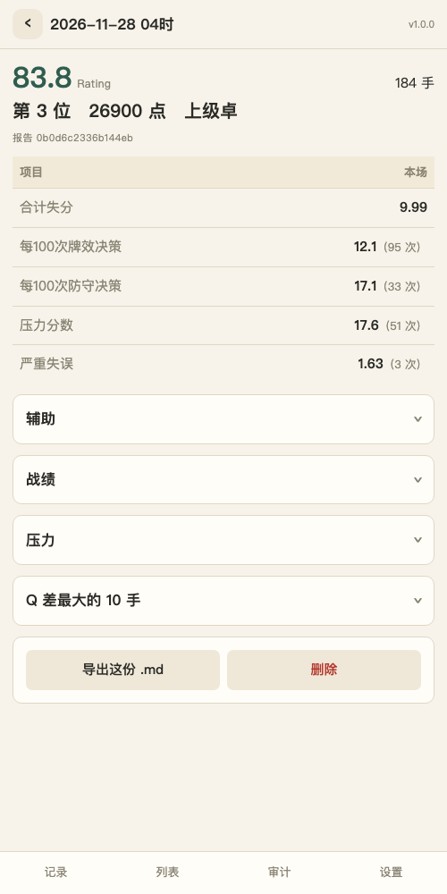

# 麻将记录 · 用 Mortal 的 Q 差给麻将水平建模

把天凤/雀魂牌谱喂给 [Mortal](https://mjai.ekyu.moe) 之后，把它的逐手 Q 值差整理成**五个可解释的指标**，并附带一套**公开、可复现**的统计检验：这五项到底测不测得出水平。

> 版本 **1.0.0**（第一个正式版）。计算核经过 127 份真实报告、19,327 个决策点的回归校验；安卓端与桌面端在同一份报告上五项指标逐位一致。

---

## 三个部分

| | 是什么 | 目录 |
|---|---|---|
| **工具（安卓）** | 粘一个牌谱链接 → 自动抓 Mortal 报告 → 算五项指标 → 存档 / 筛选 / 导出 | `app/` |
| **工具（桌面）** | 同一套算法，Python + PySide6，批量跑牌谱、导出 Excel | `desktop/` |
| **研究** | 50 场真实对局的统计检验、复现脚本、论文 | `research/` |

## 界面

| 记录 | 列表 | 详情 |
|---|---|---|
|  |  |  |

---

## 五项指标

| 指标 | 定义 |
|---|---|
| **合计失分** | 每 100 个决策的 Q 差之和（正 = 比 Mortal 的首选差多少） |
| **每100次牌效决策** | 牌效类决策里，每 100 次的失分 |
| **每100次防守决策** | 防守类决策里，每 100 次的失分 |
| **压力分数** | (立直威胁 + 隐形威胁下的失分) ÷ (两类决策次数) × 100 |
| **严重失误** | Q 差 ≥ 1.0 的手数，每 100 个决策 |

分类优先级：立直判断 → 鸣牌判断 → 防守 → 副露压力下 → 牌效；和了单列一类。

---

## 快速开始

### 安卓

从 [Releases](../../releases) 下载 `mahjong-record-1.0.0.apk` 安装（Android 7.0+）。
粘牌谱链接 → 点「取报告并记录」即可。报告只在 mjai 服务器留 15 天，App 会把原文一起存进手机。

### 校验计算核

不需要装任何依赖：

```bash
cd app
node test/test_golden.js     # 期望：PASS … 429 个字段全部一致
node test/test_filter.js     # 24 条
node test/test_chunk.js      # 8 条
node test/test_backup.js     # 14 条
```

### 自己打 APK

仓库里不含签名文件。第一次打包前先生成自己的 keystore（见 `docs/构建与签名.md`），再按 `app/docs/ANDROID_BUILD.md` 走。

### 桌面版

```bash
cd desktop
pip install -r requirements.txt
python main_qt.py            # 直接跑源码
build_win.bat                # Windows 打包（PyInstaller）
bash build_mac.sh            # macOS 打包
```

### 复现研究结果

```bash
cd research
pip install -r requirements.txt     # numpy + pandas
python3 analysis.py --md results.md
```

`analysis.py` 的输出应与仓库里的 `results.md` 一致。

---

## 数据与论文

- `research/data/数据集_50场_最新口径_去标识.csv` —— 50 场 × 91 列，已去标识（不含牌谱链接与报告 id）
- 仓库里只放**去标识**的数据；含牌谱链接的原始表没有上传（要自己重建，见 `research/build_50_latest.py` 的注释）
- `research/results.md` —— 全部统计结果
- `research/PAPER_用Q差给麻将水平建模.md` —— 论文全文

主要结论（n=48，按天聚类稳健标准误）：

| 指标 | 与单场得点的相关 | 控制对手水平后 |
|---|---|---|
| 严重失误 | −0.38 [−0.60, −0.10] | −13.9 得点 / 每 1 分，p=0.003 |
| 压力分数 | −0.34 [−0.57, −0.06] | — |
| 合计失分 | −0.24 [−0.49, +0.04] | — |
| 每100次防守决策 | −0.11 | 不显著 |
| 每100次牌效决策 | −0.02 [−0.30, +0.27] | 不显著 |

**“牌效不显著”是这个项目最重要的发现之一**：在这批样本里，它和水平（得点、顺位）都测不出关系，区间仍覆盖中等效应（[−4.05, +6.17] 得点/分）。不要把它当成“牌效不重要”，只能说“这批数据没证明它重要”。

---

## 目录

```
.
├── app/         安卓版：web/（前端与计算核）+ android/（Capacitor 壳）+ test/
├── desktop/     桌面版：mr.py / core.py / effaudit.py / fastsh.py / main_qt.py
├── research/    数据集、分析脚本、论文、预登记方案
└── docs/        历次代码审计与修复记录、构建说明
```

三端的计算核是同一套逻辑的两份实现（JS / Python），用同一份报告跑出的 429 个字段完全一致。

---

## 已知限制

- 只支持四人麻将；三麻报告会直接报错
- 依赖 Mortal 的 `details` 排序（`details[0]` 视为最优）
- 振听（同巡 / 立直后）未建模，只做现物与筋的判断
- 报告在 mjai 服务器只保留 15 天，过期后无法重新计算

---

## 许可

MIT，见 [LICENSE](LICENSE)。
数据和论文里的对局记录来自作者本人，已去标识；牌谱本身版权归天凤/雀魂。
