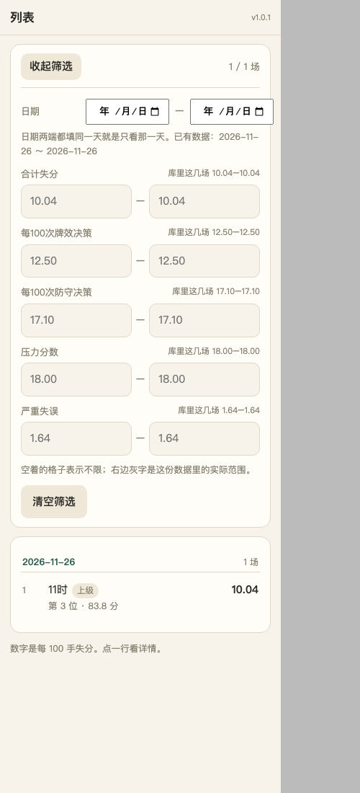

# 麻将记录 · Mortal Q 差统计与复盘

把 [Mortal](https://mjai.ekyu.moe/) 报告里的每一手 Q 差，聚合成可比较、可检验的五项指标，
并输出成可读的报告。

**这个仓库由三部分组成**：
1. **工具** —— 可用的复盘软件（网页 + Android + macOS）
2. **案例研究** —— 62 场单被试数据，检验这些指标是否真的与升段相关（不是论文，是 case study）
3. **预登记方案** —— 下一步要做的跨 4 段位层、60 人研究

> 已有 NAGA 等同类工具做逐手分析；本项目不重复它们的定位，
> 而是回答一个它们没有回答的问题：**这些指标本身可信吗**。

[](./LICENSE)
[](https://nodejs.org/)
[](./test/test_golden.js)

> ⚠️ 本项目与天凤、雀魂、Mortal 官方均无关联，是非官方爱好者工具。
> 只处理公开牌谱，不包含任何账号或登录信息。

---

## 这是什么

```
牌谱链接 ─▶ mjai.ekyu.moe ─▶ 报告 JSON ─▶ 本工具 ─▶ 统计报告
(公开)      (Mortal 4.1b)    (逐手 Q 值)   (五项+审计)  (Markdown / CSV / Excel)
```

一句话：**把「这一手亏了多少期望值」变成「这个月你在哪类决策上亏得最多」**。

### 五项指标

| 指标 | 定义 | 单位 |
|---|---|---|
| 合计失分 | 全部决策 Q 差的均值 | 每 100 手 |
| 牌效 | 限「牌效」类决策 | 每 100 次牌效决策 |
| 防守 | 限「防守」类决策 | 每 100 次防守决策 |
| **严重失误** | Q 差 ≥ 1.0 的决策数 | 每 100 手 |
| 压力分数 | 立直威胁 + 隐形威胁合并 | 每 100 次切牌 |

分类优先级：立直判断 → 鸣牌判断 → 防守 → 副露压力下 → 牌效。

### 输出

- **单场报告**：五项 + 六类归因审计 + Q 差最大的 10 手（含牌图、牌河、剩余牌）
- **逐场总表**：每场一行 × 33 列，可直接写 Excel
- **研究数据集**：每场一行 × 89 列（Q 差分档、巡目分段、对手强度、段位点）



---

## 快速开始

需要 Node 18+。

```bash
# 1. 跑通金标准测试（应输出「426 个字段全部一致」）
node test/test_golden.js

# 1b. 复现论文里的数字（应输出 62 场、严重失误 r≈-0.48）
python3 research/analysis.py

# 2. 本地预览界面
node test/preview.js        # 或双击 run_preview.command

# 3. 自己的牌谱：把报告 JSON 放进 web/data/，然后
node test/dump.js web/data/report_xxx.json
```

---

## 目录结构

```
.
├── web/                    # 网页版（Capacitor 打包成 APK，仅拷贝这一层）
│   ├── src/                # 计算核心：tiles / fastsh / mr / effaudit / core / render
│   ├── js/                 # 移动端 UI：app / detailview / auditview / db / net / rows
│   └── data/               # 金标准测试数据（已匿名）
├── test/                   # 回归测试（金标准、渲染字节比对、筛选、分块、备份压缩）
├── research/               # 研究部分：论文、方案、备忘、去标识数据集
│   └── PAPER_用Q差给麻将水平建模.md   ◀ 从这里开始读
├── docs/                   # 构建、签名、移植说明、GitHub 新手指南、代码审计修复记录
├── android/                # Capacitor Android 工程（APK 由这里构建）
└── assets/                 # 图标
```

---

## 代码审计与修复（1.0.4）

外部审计提了 20 条，已逐条用 127 份真实报告核实（不是看代码猜的）：

- **真问题、已修 14 条**：最要紧的是「摸切/手切同一张牌时整手被静默丢掉」（127 份共 61 手，0.32%）、
  「有暗杠时详情页崩溃」、「加杠把碰的三张又算一遍（可见 6 张）」、「被鸣走的舍牌从牌河删掉导致现物误判」、
  「终局残余立直棒没还给头名（7/127 份总分不是 100000）」。
- **误判 1 条**：说「零决策局会让局序错位」——实测 127/127 份局数完全对得上，不改。
- **部分成立 / 暂不修**：立直切牌的对齐策略、Mac 本地接口鉴权、内存架构、雀魂混淆链接。

逐条结论、证据、改法与数值影响都在 [`docs/代码审计修复记录.md`](./docs/代码审计修复记录.md)。
修完之后金标准从 183 手变成 184 手，426 个字段仍全部一致；旧金标准留作
`web/data/golden_0b0d6c2336b144eb.python_v1.json` 以便对照。

> 论文里的数字是用修正前的实现跑的，同一套口径、差异在 0.5% 量级；要对外发表需要重跑 `research/analysis.py`。

---

## 研究部分（可选阅读）

代码只是工具，真正的问题在 [`research/PAPER_用Q差给麻将水平建模.md`](./research/PAPER_用Q差给麻将水平建模.md)：

> 这些指标**本身**可信吗？它和升段有关系吗？在什么水平区间有效？

已完成的单被试（62 场）结果：

| 指标 | 与单场段位点变化的相关 |
|---|---|
| 严重失误 | **r = −0.48**（95% CI [−0.65, −0.26]） |
| 合计失分 | r = −0.34 |
| 防守 | r = −0.32 |
| 牌效 | r = −0.07（区间限制，不能外推为「无关」） |

并预登记了一个跨 4 个段位层、60 名玩家、每人 20 场的分层研究，
用来检验「牌效是否存在边际效应」。

---

## 数据与隐私

- 仓库内**不含**任何真实牌谱、报告原文、账号或对手信息
- `research/data/` 里的数据集已**去标识**（删除牌谱链接、报告 id）
- 测试用的金标准报告已由 mjai-reviewer 匿名化（玩家显示为 Aさん/Bさん）
- 参与者数据的收集规则见论文第 7 节

---

## 许可

[MIT](./LICENSE)。二次使用请保留版权声明。

---

## 致谢

- [Mortal](https://github.com/Equim-chan/Mortal)（Equim）— Q 值计算
- [mjai](https://github.com/Cryolite/mjai) — 牌谱格式标准
- [nodocchi](https://nodocchi.moe/) / [雀魂牌谱屋](https://amae-koromo.sapk.ch/) — 段位与对局核对
- みーにん《統計学のマージャン戦術》— 方法论的起点
